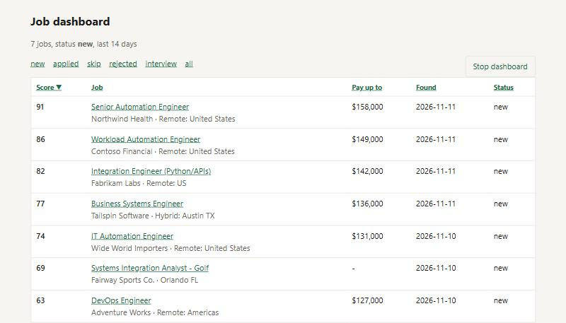

# Job finder

**Every morning, a short ranked list of jobs worth applying to, each linked to the employer's own posting.**

A daily job-search pipeline that pulls listings from 8 free public sources, normalizes them into one
schema, drops duplicates and reposts, scores each job against your titles, skills and pay floor, finds the
posting on the employer's own hiring system, and writes a ranked report plus a tracker you can work from a
local dashboard.


<sub>Dashboard shown with made-up demo jobs.</sub>

**It never applies to anything.** You read the report, open the links you like, and submit yourself.
Auto-apply bots spray low-quality applications and get accounts flagged; this does the boring part
(finding and filtering) and leaves the judgment to you.

Core pipeline is pure Python standard library: no installs, no API keys, no accounts.

### A report entry

```markdown
### 1. Senior Automation Engineer at Northwind Health (score 91)
- **Where:** Remote: United States | **Pay:** $132,000–$158,000 | **Posted:** 2026-11-10 | via Himalayas
- **Why:** title: automation engineer; skill match: 6 of 7 (86%); your skills: python, sql, powershell, rest api, servicenow, power automate; gaps: databricks; pay up to $158,000; remote
- **Link:** https://jobs.ashbyhq.com/northwind/... (employer) | [listing](https://himalayas.app/...)
- **Tracker ID:** `a1b2c3d4e5f6`
```

### Engineering highlights

- **Resilient fetching:** each source is isolated, so one broken feed is logged and skipped while the run finishes.
- **One schema from eight shapes:** JSON APIs, RSS, a Workday feed and an HTML scrape all normalize to the same fields,
  with salary parsing that refuses to read non-USD pay as dollars.
- **Real de-duplication:** cross-source duplicates, already-seen jobs, and reposts under a different company name
  (matched on title plus a shared stretch of description).
- **Explainable scoring:** every score lists its reasons, so you can tune `config.json` instead of trusting a black box.
- **Employer links:** kept jobs are looked up on the employer's Ashby, Greenhouse or Lever board in parallel, so you
  apply at the source instead of through an aggregator.
- **Honest AI, kept optional:** the Gemini cover-letter writer may only use your own facts file, and a second model
  pass flags any sentence the facts don't back up.
- **Private by default:** your answers, tracker, reports and letters are all git-ignored and never leave your machine.

## Quick start

```bash
git clone <this repo>
cd job-finder
python setup.py        # 7 questions: titles, pay floor, home state, relocation, industry, skills, gaps
python job_finder.py   # about 3-4 minutes -> reports/<date>.md and tracker.csv
```

Run it again tomorrow and you only see jobs that are new since the last run.

```bash
python job_finder.py --only himalayas,remotive   # just some sources
python job_finder.py --all                       # include jobs you've already seen
python job_finder.py --kit <TrackerID>           # save one job's full posting to kits/ for cover-letter drafting
```

## What it does

1. **Fetches** from every source (one broken feed is logged and skipped, not fatal).
2. **Normalizes** each listing to the same fields: title, company, location, pay, description, posted date.
   Salaries come from structured fields when a source has them, otherwise from text like `$120k` or `$120,000`.
   Non-USD pay is treated as unlisted instead of being misread as dollars.
3. **De-duplicates**: the same job from two sources, jobs you've already seen (`seen.json`), and reposts of
   a job under a different company name (same title plus a matching stretch of description).
4. **Filters** out titles you'd never take, clearance-only or region-locked postings, remote jobs that aren't
   open to the US, and jobs whose posted pay tops out below your floor.
5. **Scores** what's left: title match tier, skill coverage (of the tools the posting names that are on your
   `skills` or `gaps` lists, the share you have: 5 of 7 scores well above 1 of 7, worth up to `skill_points`,
   with partial credit when fewer than `skill_full_at` tools are named), pay listed, remote, your preferred
   places, and your dream industry. Non-golf jobs that name at least `min_coverage_from` (5) of those tools
   and where you have under `min_coverage` (40%) are dropped; with fewer tools named, the share is too noisy to judge.
6. **Links to the employer**: each kept job is looked up on the company's Ashby, Greenhouse or Lever board. A match
   becomes the main link (the job-board link stays alongside); no match gets a "find on their careers page" search link.
7. **Reports** the top matches with the reasons for each score, and appends them to `tracker.csv`, where you
   mark each one `applied` or `skip`.

## Cost-of-living pay floor

Remote jobs need your `salary_min`. On-site and hybrid jobs need whatever matches it where you live now,
after local prices: `salary_min x place / home`, using the BEA's 2024 Regional Price Parities for all 50
states and DC plus a handful of expensive metros. A $100k floor in Texas becomes about $114k in California
and $119k in San Francisco. The index covers prices only, not income tax. BEA publishes new figures each
December; update `col` in `config.json` when it does.

## Sources

All free and public. LinkedIn and Indeed are left out on purpose: their terms ban scraping.

| Source | What | Notes |
|---|---|---|
| Himalayas | Remote jobs, often with salary | Search API, uses your titles |
| Remotive | Remote tech jobs | API terms ask for a link back; every report entry links the source |
| Jobicy | Remote jobs by tag | Same credit rule; tags in `jobicy_tags` |
| RemoteOK | Latest 100 remote jobs | Same credit rule |
| HN Who's Hiring | The monthly Hacker News thread | Startups, often with pay listed |
| TeamWork Online | Sports-industry job boards | Page scrape; used by the golf pack |
| Workday | Any company's Workday careers site | Public JSON feed; used by the golf pack |
| golf-jobs.com | Golf-industry aggregator | Public RSS; used by the golf pack |

## Industry packs

A pack is a JSON file in `packs/` that adds a dream industry: its keywords, the company boards to read,
and a label for its own report section. Jobs in your dream industry always get listed, with a bonus,
and get a looser title filter (an IT manager at your dream company is worth a look).

The included **golf pack** reads the PGA TOUR, PGA of America, USGA, Topgolf, Acushnet (Titleist/FootJoy),
TaylorMade and Topgolf Callaway Brands boards plus golf-jobs.com. To make your own, copy
`packs/golf.json`, swap in your industry's keywords and boards, and pick it in `setup.py`. Find a
company's Workday board on its careers page (the URL looks like `company.wd5.myworkdayjobs.com/SiteName`);
don't guess.

## Configuration

Settings are layered, last one wins:

1. `config.json`: shared defaults (title tiers, exclusions, the cost-of-living table)
2. `packs/<name>.json`: any packs you turned on
3. `my_config.json`: your answers from `setup.py`, which is git-ignored along with everything the finder
   writes about your search (`tracker.csv`, `seen.json`, `reports/`, `kits/`)

Edit `my_config.json` directly for anything setup doesn't ask, like `min_score` or extra `title_exclude` words.

## Run it every morning

Windows Task Scheduler: create a daily task that runs `pythonw.exe job_finder.py` in this folder. With no
console attached it logs to `daily.log`. On macOS/Linux, a cron line like
`0 7 * * * cd /path/to/job-finder && python3 job_finder.py` does the same.

## Cover letters with Gemini (optional)

`letters.py` drafts a cover letter for one tracked job with the Gemini API, and `dashboard.py` puts a
**Write cover letter** button next to every job. You still read every letter and apply yourself.

How it keeps letters honest:

1. **Facts file.** Copy `facts.example.md` to `my_facts.md` (git-ignored) and list what you've actually done,
   worded the way you want it, plus a "Not yet" list of things you can't claim. The writer may only use this file.
2. **Fact check.** A second Gemini call reads the draft against the facts file and flags any sentence that
   isn't backed up, overstates it ("built" where the facts say "maintain"), or claims something under "Not yet".
   The flags show above the letter.
3. **Human review.** Nothing is sent anywhere. You get the text and a Word file, and you decide.

Job postings are treated as data: the prompt tells the model to ignore instructions inside them, and the
fact check plus your own read catch anything that slips through.

Setup (Windows):

```
py -m venv .venv
.venv\Scripts\python.exe -m pip install -r requirements-letters.txt
setx GEMINI_API_KEY "<your key>"        (then open a new terminal)
.venv\Scripts\python.exe letters.py <TrackerID>     # one letter from the command line
.venv\Scripts\python.exe dashboard.py               # then open http://127.0.0.1:5000
```

No console window: point a desktop shortcut at `.venv\Scripts\pythonw.exe open_dashboard.pyw` (icon:
`assets\dashboard.ico`). It starts the dashboard in the background and opens your browser; the page's
**Stop dashboard** button shuts it down.

Models are tried in the order of `letter_models` in `config.json`; busy or failing ones are skipped. Word
files go to `letters_dir` and are never overwritten (a second letter for the same company gets `_v2`).
The dashboard only listens on 127.0.0.1 and rejects form posts from other sites.

## License

MIT
